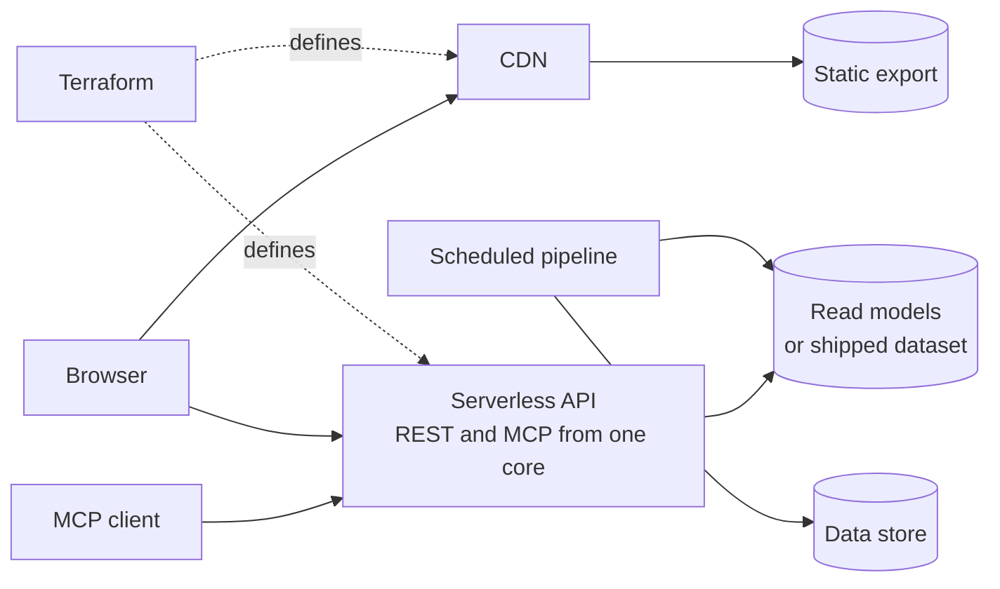

This page lists the architecture and design patterns used across the portfolio projects, the problem each one answers and where it can be seen.

## At a glance

| Topic | Summary |
|---|---|
| Architecture style | Static frontend, serverless backend, no always-on server |
| Data | CQRS with precomputed read models, single-table design, data shipped with the code |
| Interfaces | One core serving a REST API and an MCP endpoint, contract-first APIs |
| Frontend | Design tokens, typed bilingual content, work moved to build time |
| Delivery | Infrastructure as code, keyless CI/CD, cost guardrails |

## How the patterns fit together

The same shape runs in the three projects, at different sizes. Holiday Atlas has no pipeline and no data store: its dataset ships with the function. NexusBench has the full picture. The portfolio site has only the static export and one small API.

## Architecture

| Pattern | Problem it answers | Where it is used | Evidence |
|---|---|---|---|
| Static-first delivery | A web server costs money and can fail. A static export behind a CDN has neither problem | All three projects | [Holiday Atlas architecture](https://github.com/holiday-atlas-org/documentation/blob/main/02-technical/architecture.md) |
| Serverless functions only | The stack must stay under a small monthly cost ceiling | All three projects | [rafikadiche.com](../02-projects/portfolio-site.md) |
| CQRS with precomputed read models | Every reader sees the same data between two pipeline runs, so views are built once and served from storage and the edge cache | NexusBench | [NexusBench](../02-projects/nexusbench.md) |
| Event-driven pipeline | Ingestion and projection run on a schedule, apart from the read path, and can be replayed | NexusBench | [NexusBench](../02-projects/nexusbench.md) |
| One core, two interfaces | A REST API and an MCP endpoint read the same rules or views through the same code | Holiday Atlas, NexusBench | [Holiday Atlas API reference](https://github.com/holiday-atlas-org/documentation/blob/main/02-technical/api-reference.md) |
| Site and API on one domain | Removes cross-origin configuration and build-time API addresses | NexusBench | [NexusBench](../02-projects/nexusbench.md) |
| Data shipped with the code | The data changes rarely and fits in memory, so no database is run | Holiday Atlas | [Holiday Atlas architecture](https://github.com/holiday-atlas-org/documentation/blob/main/02-technical/architecture.md) |

## Backend and data

| Pattern | Problem it answers | Where it is used | Evidence |
|---|---|---|---|
| Rules resolved at request time | A list of dates is out of date a year later. A rule is computed for the year a client asks for | Holiday Atlas | [Holiday Atlas backend](https://github.com/holiday-atlas-org/documentation/blob/main/02-technical/backend.md) |
| Single-table DynamoDB design | Access patterns are few and known in advance | NexusBench | [NexusBench](../02-projects/nexusbench.md) |
| Shared contract library | Every service, the pipeline and the API agree on one schema, checked at each boundary | NexusBench | [NexusBench](../02-projects/nexusbench.md) |
| Additive-only schemas | Clients read views written by older code, so a view only gains fields, and a test enforces it | NexusBench | [NexusBench](../02-projects/nexusbench.md) |
| Contract-first APIs | The OpenAPI specification is the public contract and drives the interactive reference | Holiday Atlas, NexusBench | [Holiday Atlas OpenAPI](https://holiday-atlas.rafikadiche.com/openapi.json), [NexusBench OpenAPI](https://nexusbench.rafikadiche.com/api/v1/openapi.json) |
| Standard error format | Errors follow one documented shape and reveal no internal detail | Holiday Atlas, NexusBench | [Holiday Atlas API reference](https://github.com/holiday-atlas-org/documentation/blob/main/02-technical/api-reference.md) |
| Curated data reviewed like code | Hand-curated values change through a reviewed commit, with an export and a sanity check before they ship | Holiday Atlas, NexusBench | [Holiday Atlas operations](https://github.com/holiday-atlas-org/documentation/blob/main/03-quality/operations.md) |
| Fail-closed verification | A form submission is refused when the anti-spam check cannot be confirmed | rafikadiche.com | [rafikadiche.com](../02-projects/portfolio-site.md) |

## Frontend

| Pattern | Problem it answers | Where it is used | Evidence |
|---|---|---|---|
| Design tokens as CSS custom properties | One source for colour, type and spacing, in light and dark themes | Holiday Atlas, NexusBench | [Holiday Atlas UX design](https://github.com/holiday-atlas-org/documentation/blob/main/01-functional/ux-design.md) |
| Typed bilingual content | A missing translation fails the build before it can reach production | All three projects | [Holiday Atlas frontend](https://github.com/holiday-atlas-org/documentation/blob/main/02-technical/frontend.md) |
| Reader-specific results computed in the browser | The server stays stateless and stores no personal data | NexusBench | [NexusBench](../02-projects/nexusbench.md) |
| Work moved to build time | Geometry computed in the browser blocked the page, so it is computed once at build time and saved | Holiday Atlas | [Holiday Atlas case study](../02-projects/holiday-atlas.md), [Holiday Atlas architecture](https://github.com/holiday-atlas-org/documentation/blob/main/02-technical/architecture.md) |
| Performance budget in continuous integration | A size regression fails the build before it ships | Holiday Atlas | [Holiday Atlas frontend](https://github.com/holiday-atlas-org/documentation/blob/main/02-technical/frontend.md) |

## Infrastructure and delivery

| Pattern | Problem it answers | Where it is used | Evidence |
|---|---|---|---|
| Infrastructure as code with remote state | Manual changes drift and leave no record | All three projects | [rafikadiche.com](../02-projects/portfolio-site.md), [Holiday Atlas infrastructure](https://github.com/holiday-atlas-org/documentation/blob/main/02-technical/infrastructure.md) |
| Private origin behind the CDN | The storage bucket is never reached directly | All three projects | [Holiday Atlas infrastructure](https://github.com/holiday-atlas-org/documentation/blob/main/02-technical/infrastructure.md) |
| Keyless CI/CD | Deploys use short-lived credentials from OIDC, so no cloud key is stored in the repository | NexusBench, rafikadiche.com | [rafikadiche.com](../02-projects/portfolio-site.md) |
| Least-privilege roles | Each function and each deploy identity can touch only what it needs | Holiday Atlas, NexusBench | [Holiday Atlas security](https://github.com/holiday-atlas-org/documentation/blob/main/03-quality/security.md) |
| Cost guardrails | A budget with alerts makes a cost surprise visible early | All three projects | [Holiday Atlas infrastructure](https://github.com/holiday-atlas-org/documentation/blob/main/02-technical/infrastructure.md) |
| Smoke test after deploy | Each deploy is checked against the live site and API | Holiday Atlas, NexusBench | [Holiday Atlas operations](https://github.com/holiday-atlas-org/documentation/blob/main/03-quality/operations.md) |
