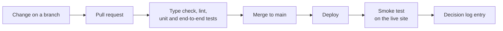

# Engineering practices

[Documentation index](../README.md)

This page describes how the work is done, practice by practice, and links to the project page that holds the results.

## At a glance

| Topic | Summary |
|---|---|
| Testing | Unit, component, end-to-end, accessibility and contract tests, with coverage gates |
| Delivery | Checks on every pull request, automated deploys, a smoke test on the live site |
| Infrastructure | Everything defined in Terraform, plans read before they are applied |
| Security | Controls by category: transport, access, input, secrets, supply chain |
| Accessibility and performance | WCAG 2.1 AA as the target, size budgets, Lighthouse audits |
| Documentation | Decisions logged with their reason, gaps stated as they are |
| AI-assisted work | Agents write under review, with human checkpoints and cost caps |

Figures such as test counts, coverage and audit scores are not copied here. They sit in each project's documentation, next to the date they were measured.

## From change to production

## Practices

| Practice | How it is applied | Evidence |
|---|---|---|
| Unit and component testing | Logic that can be a pure function is one, with a test next to it. Components are tested through what a user sees | [Holiday Atlas testing](https://github.com/holiday-atlas-org/documentation/blob/main/03-quality/testing.md) |
| End-to-end testing | Playwright on Chromium, Firefox, WebKit and a phone viewport for the frontend. Supertest against a local database for the services | [Holiday Atlas testing](https://github.com/holiday-atlas-org/documentation/blob/main/03-quality/testing.md), [NexusBench](../02-projects/nexusbench.md) |
| Coverage and contract gates | An enforced coverage threshold on pure logic and domain code, and a compatibility test on published schemas | [Holiday Atlas testing](https://github.com/holiday-atlas-org/documentation/blob/main/03-quality/testing.md), [NexusBench](../02-projects/nexusbench.md) |
| Continuous integration and delivery | GitHub Actions runs the checks on every pull request and deploys on a merge to the main branch | [Holiday Atlas operations](https://github.com/holiday-atlas-org/documentation/blob/main/03-quality/operations.md), [rafikadiche.com](../02-projects/portfolio-site.md) |
| Infrastructure as code | Terraform with remote state. A plan is read in full before it is applied | [Holiday Atlas infrastructure](https://github.com/holiday-atlas-org/documentation/blob/main/02-technical/infrastructure.md), [rafikadiche.com](../02-projects/portfolio-site.md) |
| Security by category | HTTPS only, least-privilege roles, validated input, errors with no internal detail, locked and scanned dependencies | [Holiday Atlas security](https://github.com/holiday-atlas-org/documentation/blob/main/03-quality/security.md) |
| Accessibility | WCAG 2.1 AA is the target. Automated scans run inside the end-to-end suite, in both themes | [Holiday Atlas audit](https://github.com/holiday-atlas-org/documentation/blob/main/03-quality/audit.md) |
| Performance | A first-load JavaScript budget fails the build when exceeded. Lighthouse audits are dated | [Holiday Atlas audit](https://github.com/holiday-atlas-org/documentation/blob/main/03-quality/audit.md) |
| Code quality | TypeScript in strict mode and ESLint, with a file length limit in the Holiday Atlas frontend | [Holiday Atlas frontend](https://github.com/holiday-atlas-org/documentation/blob/main/02-technical/frontend.md) |
| Cost control | A monthly ceiling decided before the design, budgets with alerts, serverless services billed by use | [rafikadiche.com](../02-projects/portfolio-site.md), [Holiday Atlas infrastructure](https://github.com/holiday-atlas-org/documentation/blob/main/02-technical/infrastructure.md) |
| Decision logging | Each real decision is written down with its reason and its consequence. A reversed decision stays in the log, marked as reversed | [rafikadiche.com](../02-projects/portfolio-site.md), [Holiday Atlas architecture](https://github.com/holiday-atlas-org/documentation/blob/main/02-technical/architecture.md) |
| Public documentation | Each project has functional, technical and quality pages. Test and audit gaps are reported as they are, with planned work marked as planned | [Holiday Atlas documentation](https://github.com/holiday-atlas-org/documentation) |

## AI-assisted work

| Practice | How it is applied | Evidence |
|---|---|---|
| Agent-assisted delivery | Code and documentation are written with Claude Code. Each change is read, built and checked before it ships, and what was not checked is stated | [rafikadiche.com](../02-projects/portfolio-site.md) |
| Multi-agent workflows | A CrewAI workflow produced the NexusBench dashboard specification. It stops for human review after each phase, and each run has a cost cap and a ledger of model calls | [NexusBench](../02-projects/nexusbench.md) |
| Products that AI clients can call | Both public APIs are also exposed as MCP tools, read-only | [Holiday Atlas API reference](https://github.com/holiday-atlas-org/documentation/blob/main/02-technical/api-reference.md), [NexusBench](../02-projects/nexusbench.md) |
| No agent in production | Agents work at design time and build time. No model call sits on a request path | [NexusBench](../02-projects/nexusbench.md) |

## Status and gaps

| Item | Status |
|---|---|
| Staging environments | None, by decision. Each project has local development and production |
| Automated tests on the rafikadiche.com frontend | Planned. The checks today are the type check and the production build |
| Automated deploy of the rafikadiche.com frontend | Planned. It is deployed by hand |
| Automated deploy of the Holiday Atlas backend and infrastructure | Planned. See [Holiday Atlas operations](https://github.com/holiday-atlas-org/documentation/blob/main/03-quality/operations.md) |
