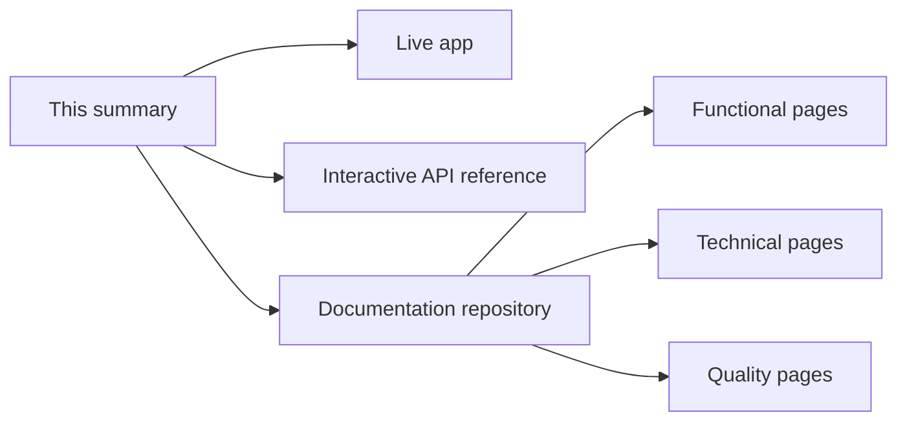

# Holiday Atlas

[Documentation index](../README.md)

Holiday Atlas is a free public API, an MCP server and a web app for public holidays around the world, shown on an interactive globe in English and French.

## At a glance

| Topic | Summary |
|---|---|
| Product | Public holiday web app, public REST API and MCP server |
| Role | Designed, built, deployed and run by one person |
| Frontend | Next.js static export, React, TypeScript, Tailwind CSS, D3 canvas globe |
| Backend | Node.js on AWS Lambda from a container image, TypeScript, zod, OpenAPI 3, Model Context Protocol |
| Data | A hand-curated dataset of recurring rules across the Gregorian, Hijri, Hebrew and Chinese calendars |
| Infrastructure | Terraform, Amazon CloudFront, S3, Lambda function URL, ECR, Route 53, ACM |
| Quality | Vitest, React Testing Library, Playwright on four browser projects, axe-core scans, GitHub Actions, a performance budget |

## Where to look

| Link | What it shows |
|---|---|
| [holiday-atlas.rafikadiche.com](https://holiday-atlas.rafikadiche.com) | The live app |
| [Interactive API reference](https://holiday-atlas.rafikadiche.com/docs.html) | The REST routes, callable from the page |
| [Documentation repository](https://github.com/holiday-atlas-org/documentation) | The full documentation: functional, technical and quality pages |
| [Architecture](https://github.com/holiday-atlas-org/documentation/blob/main/02-technical/architecture.md) | How the parts fit together, and the technical decisions with their reasons |
| [Backend](https://github.com/holiday-atlas-org/documentation/blob/main/02-technical/backend.md) | The rule engine and the dataset pipeline |
| [API reference](https://github.com/holiday-atlas-org/documentation/blob/main/02-technical/api-reference.md) | REST routes, MCP tools and how to connect a client |
| [Testing](https://github.com/holiday-atlas-org/documentation/blob/main/03-quality/testing.md) | Test levels, results and the status of each repository |

## What it demonstrates

- Holidays are stored as rules and resolved for the requested year, so the dataset does not go stale.
- The system is a static site and one function, with no database and no call to another service at run time.
- The REST API and the MCP endpoint read the same rules through the same code.
- The globe is drawn on a canvas, and its geometry is precomputed at build time to keep the page responsive.
- Cross-browser end-to-end tests, accessibility scans in both themes and a size budget run in continuous integration.

## Status and gaps

The project's own pages carry a "Status and gaps" section each. The summary of open work is on its [Testing](https://github.com/holiday-atlas-org/documentation/blob/main/03-quality/testing.md) and [Operations](https://github.com/holiday-atlas-org/documentation/blob/main/03-quality/operations.md) pages.
