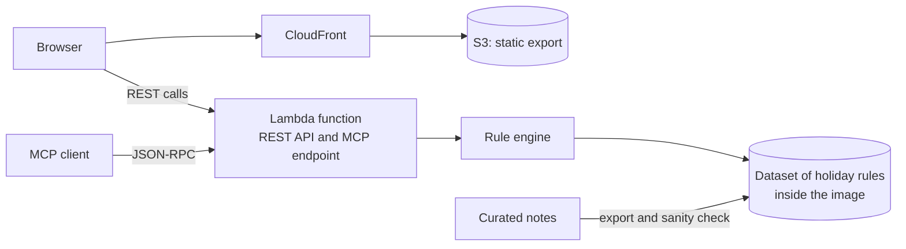

# Holiday Atlas

[Documentation index](../README.md)

Holiday Atlas is a free public API, an MCP server and a web app for public holidays around the world, shown on an interactive globe in English and French. This page is a one-page case study: how it is built, and how its frontend was rebuilt without a visible change.

## At a glance

| Topic | Summary |
|---|---|
| Product | Public holiday web app, public REST API and MCP server |
| Role | Designed, built, deployed and run by one person |
| Frontend | Next.js static export, React, TypeScript, Tailwind CSS, D3 canvas globe |
| Backend | Node.js on AWS Lambda from a container image, TypeScript, zod, OpenAPI 3, Model Context Protocol |
| Data | A hand-curated dataset of recurring rules across the Gregorian, Hijri, Hebrew and Chinese calendars |
| Infrastructure | Terraform, Amazon CloudFront, S3, Lambda function URL, ECR, Route 53, ACM |
| Quality | Vitest, React Testing Library, Playwright on four browser projects, axe-core scans, GitHub Actions, a performance budget |
| Delivery | GitHub Actions for the frontend. The function and the infrastructure are released by hand |
| Environments | Local development and production |

## Problem and constraints

Public holidays differ from one country to the next, and many of them move every year. Easter shifts with the moon, some holidays fall on the nth weekday of a month, and others follow the Hijri, Hebrew or Chinese calendar. A list of dates for one year is out of date a year later.

Holiday Atlas answers one question, which days are public holidays in a given year, for people in a web app, for programs in a REST API and for AI assistants through MCP. Four constraints shaped every choice:

- Free to use, with no account and no API key.
- No database and no always-on server to run or pay for.
- No call to a third-party holiday feed at run time, so answers stay available and consistent.
- One maintainer, who curates the data by hand.

## Architecture

Each holiday is stored once, as a rule: a fixed date, an offset from Easter, the nth weekday of a month or a date on another calendar. The function resolves the rules for the year a client asks for, so nothing has to be republished each January. The dataset ships inside the function's container image, and the REST routes and the MCP endpoint read it through the same code. The site is a static export served from a private S3 bucket through CloudFront, and the browser calls the API directly.

## The frontend rewrite

The first version of the site worked, but it was hard to change safely. Most of the interface lived in three long files, nothing was tested, assets were served uncompressed, and the globe computed its geometry in the browser at startup, which froze the page before it could be used.

In October 2026 the frontend was rebuilt under one rule: visitors see no difference except speed. A written plan set the goals, the non-goals (no visible change, no new runtime dependency, no dependency upgrade) and the cases where work had to stop for a decision. The work then ran as eight pull requests, one per phase, and a phase merged only when continuous integration passed.

| Step | What changed | Why at this point |
|---|---|---|
| Measure | Bundle size, startup work and Lighthouse recorded on the existing build | Every later claim needed a baseline |
| Fix delivery | Compression, HTTP/3 and cache lifetimes at the edge, through Terraform | The cheapest gain, with no code change |
| Lock in behaviour | End-to-end tests written against the existing site, on four browser projects, with accessibility scans | The refactor needed a net that catches any visible change |
| Add the harness | Unit tests, lint and a pipeline that deploys from the main branch | Every later phase had to pass the same checks |
| Split the code | Page shell, calendar, globe and country selector moved into small components, hooks and pure functions, with a file length cap in ESLint | Pure logic can be unit tested, and small files can be reviewed |
| Make it fast | The globe loads in steps, its geometry is computed at build time, and a size budget runs in continuous integration | The startup freeze came from work the browser did not need to do |

Behaviour was pinned down before any code moved, so each refactoring pull request could be judged on one question: did a test have to change? The speed changes have guards too. When the globe's geometry moved to build time, a unit test was added that fails when the saved file no longer matches the map data. The size budget protects the bundle the same way: a later change that undoes the gain fails the build.

The same rule delayed two fixes. The new accessibility scans found text below the WCAG AA contrast ratio and buttons nested inside the month tiles, and both fixes would have been visible. They were held back, then made right after the rewrite in their own pull requests, once a visible change was approved. The scans now run with no rule exempted.

The phases were run with Claude Code from the written plan. Its stop conditions sent anything visible, any test that could only pass by being weakened and any infrastructure plan beyond the expected change back for a human decision.

The measured results are on the Holiday Atlas [Audit](https://github.com/holiday-atlas-org/documentation/blob/main/03-quality/audit.md) page, each with the date and the place it was taken. First-load JavaScript is a fraction of what it was, and the long freeze at startup is gone. Blocking time on a slowed mobile CPU is still above its target.

## Technical decisions

| Decision | Reason | Consequence |
|---|---|---|
| Store holidays as rules and resolve them per year | A list of dates is out of date a year later | The same dataset serves every year. A sanity check compares resolved dates with known ones |
| Ship the dataset inside the function | The data changes rarely and fits in memory | No database to run or pay for. A data change needs a new release |
| No third-party holiday feed at run time | Answers stay available whatever happens upstream | The dataset is curated by hand and changes through a reviewed commit |
| Use the runtime's built-in support for the Hijri, Hebrew and Chinese calendars | It avoids writing astronomical algorithms by hand | Hijri dates are flagged as estimated, because the observed date depends on a moon sighting |
| Leave out a holiday whose date cannot be computed reliably | A wrong date is worse than a missing one | Coverage is stated as it is, with no guessed dates |
| One function for the REST routes and the MCP endpoint, with a small MCP handler written for it | Both read the same rules, and a short-lived function cannot host a long-running MCP server | One release and one set of limits. A full MCP server runs in local development on the same tools module |
| Static export for the frontend | No server to run or pay for | Everything dynamic happens in the browser |
| Rate limit inside the function | No extra service is needed | A client over the limit gets a clear answer with a waiting time |

## Where to look

| Link | What it shows |
|---|---|
| [holiday-atlas.rafikadiche.com](https://holiday-atlas.rafikadiche.com) | The live app |
| [Interactive API reference](https://holiday-atlas.rafikadiche.com/docs.html) | The REST routes, callable from the page |
| [Documentation repository](https://github.com/holiday-atlas-org/documentation) | The full documentation: functional, technical and quality pages |
| [Architecture](https://github.com/holiday-atlas-org/documentation/blob/main/02-technical/architecture.md) | How the parts fit together, with every technical decision and its reason |
| [Frontend](https://github.com/holiday-atlas-org/documentation/blob/main/02-technical/frontend.md) | The code structure after the rewrite, the globe and the performance budget |
| [API reference](https://github.com/holiday-atlas-org/documentation/blob/main/02-technical/api-reference.md) | REST routes, MCP tools and how to connect a client |
| [Testing](https://github.com/holiday-atlas-org/documentation/blob/main/03-quality/testing.md) | Test levels, results and the status of each repository |
| [Audit](https://github.com/holiday-atlas-org/documentation/blob/main/03-quality/audit.md) | Performance, accessibility and code quality, before and after the rewrite |
