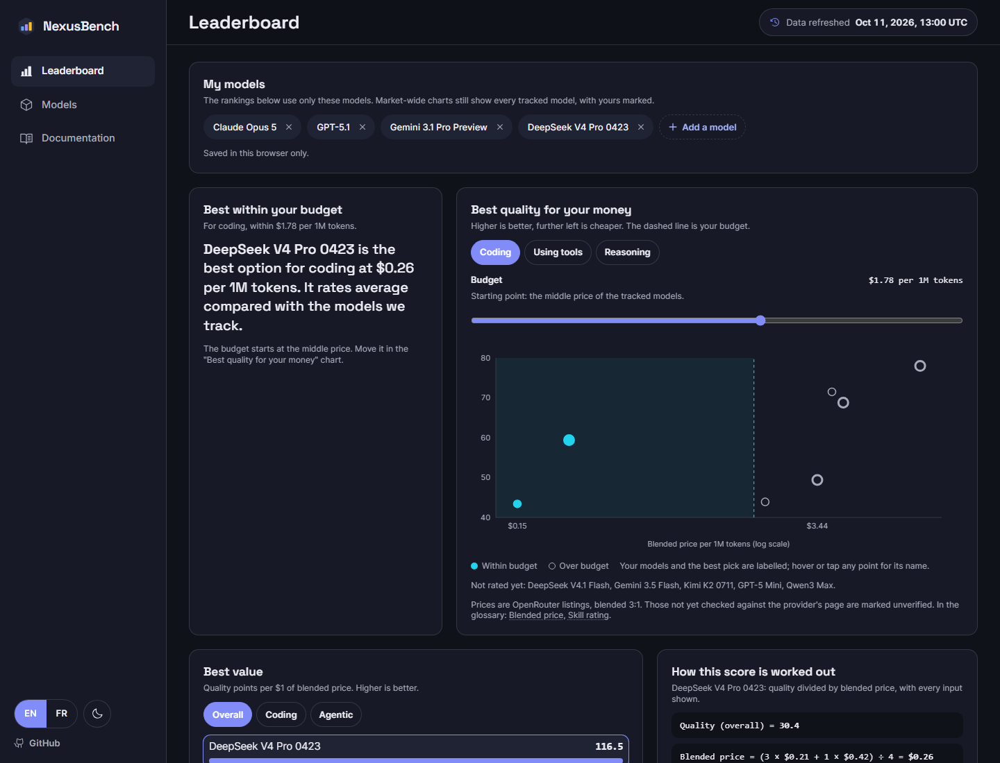
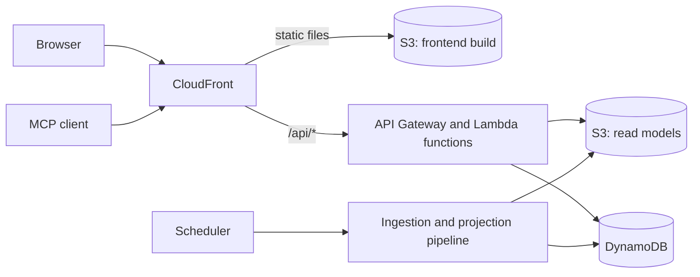

# NexusBench

[Documentation index](../README.md)

NexusBench is a web dashboard that compares language models on benchmark scores and token prices, with a public REST API and an MCP server over the same data.

## At a glance

| Topic | Summary |
|---|---|
| Product | Model comparison dashboard, public REST API, MCP server |
| Role | Designed, built, deployed and run by one person |
| Frontend | Next.js static export, React, TypeScript, Tailwind CSS, Recharts |
| Backend | NestJS on AWS Lambda, TypeScript, zod, OpenAPI 3, Model Context Protocol |
| Data | Amazon DynamoDB with a single-table design, precomputed read models in Amazon S3, CQRS |
| Infrastructure | Terraform, Amazon CloudFront, S3, API Gateway, Step Functions, EventBridge, Route 53, ACM |
| Quality | Jest unit tests, Supertest end-to-end tests, a schema compatibility test, GitHub Actions, Lighthouse |
| Design | Personas, design tokens, light and dark themes, responsive layout, English and French |

## How it works

One CloudFront distribution serves the static site and the API. A scheduled pipeline collects the data, precomputes what every reader sees and stores it as JSON for the API to serve. Results that depend on a reader's own settings are computed in the browser, so the server stays stateless and stores no personal data.

## Where to look

| Link | What it shows |
|---|---|
| [nexusbench.rafikadiche.com](https://nexusbench.rafikadiche.com) | The live app |
| [Swagger UI](https://nexusbench.rafikadiche.com/api/docs) | The REST routes, callable from the page |
| [OpenAPI specification](https://nexusbench.rafikadiche.com/api/v1/openapi.json) | The machine-readable contract |

## What it demonstrates

- Writing and reading are separate paths. A pipeline writes to one table and projects JSON views, and most requests are answered from storage and the edge cache without reaching a function.
- The backend is made of independent services that share data stores and events, with no service-to-service HTTP calls.
- One contract library is validated at every boundary. Its schemas only gain fields, and a test enforces the rule.
- The site and the API share one domain, which removes cross-origin configuration and build-time API addresses.
- An agent workflow with human review points produced the personas, a needs specification, a widget catalog and coded mockups before the dashboard code was written.

## Status and gaps

| Item | Status |
|---|---|
| Documentation repository | Written, not public yet. The link is added here when it is published |
| Deep links from the profile pages | Planned, once the documentation repository is public |
