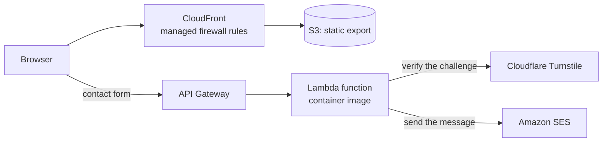

# rafikadiche.com

[Documentation index](../README.md)

rafikadiche.com is a bilingual static site with one serverless contact API, built and run by one person under a cost ceiling of €10 a month.

## At a glance

| Topic | Summary |
|---|---|
| Product | Portfolio site in English and French, with a contact form |
| Role | Designed, built, deployed and run by one person |
| Frontend | Next.js static export, React, TypeScript, Tailwind CSS, Formik |
| Contact API | Node.js on AWS Lambda from a container image, Amazon API Gateway, Amazon SES |
| Infrastructure | Terraform in layers, Amazon CloudFront, S3, Route 53, ACM, ECR |
| Delivery | GitHub Actions with OIDC for the contact API, manual deploy for the site |
| Environments | Local development and production |

## Problem and constraints

The site exists to win freelance work, so being live and credible mattered more than being complete. Four constraints shaped every choice:

- A hard ceiling of €10 a month for everything.
- One maintainer, with no design or content partner.
- Two languages, with English as the source.
- No server to operate: static files, and a function only where one is needed.

## Architecture

The pages are built once and served from a private S3 bucket through CloudFront. The only dynamic part is the contact form. Its API validates the message, confirms the anti-spam challenge on the server and sends an email. Nothing is stored.

## The Terraform decision

Terraform was dropped on 2026-08-06, before launch. The stack was four resources in one environment with one maintainer, and untested infrastructure code under a deadline was the larger risk. The first version was set up by hand in the console.

That choice accepted a known risk, drift, and drift caused two failures within a week: a stale alias on the CDN distribution, then a TLS certificate that ended in a failed state with no record of why. On 2026-08-12 the decision was reversed. The live resources were imported and reconciled as code until a plan showed no difference.

Both decisions fit their moment: the first protected the launch date, and the second followed once drift had caused real failures. The reversal stays in the decision log, marked as reversed.

## Technical decisions

| Decision | Reason | Consequence |
|---|---|---|
| Static export, no request-time rendering | No server to run or pay for | Everything dynamic happens in the browser or in the contact API |
| Serverless-static first, no Kubernetes | The cost ceiling rules out an always-on platform | Running cost is about €2 a month (September 2026) |
| Terraform in layers: bootstrap, then platform | State and deploy identities must exist before the resources that use them | Each layer has its own state and can be planned alone |
| Contact form through a function, with no database | A message only needs to reach an inbox | No personal data is kept on the server |
| Spam checks in order: honeypot, validation, server-side challenge check that fails closed | A challenge token is useless unless the server verifies it | A submission is refused when the check cannot be confirmed |
| Keyless deploys for the contact API | No cloud key stored in the repository | GitHub Actions gets short-lived credentials through OIDC, with trust pinned to the repository's immutable identifiers |
| No staging environment | Cost and a single maintainer | Changes go from local development to production |

## Status and gaps

| Item | Status |
|---|---|
| Contact API tests | Unit tests with the Node.js test runner |
| Contact API deploy | Automated on a merge to the main branch |
| Frontend tests | Planned. The checks today are the type check and the production build |
| Frontend deploy | Planned. Build, upload and cache invalidation are run by hand |
| Repository settings as code | Written in Terraform, not applied yet |
