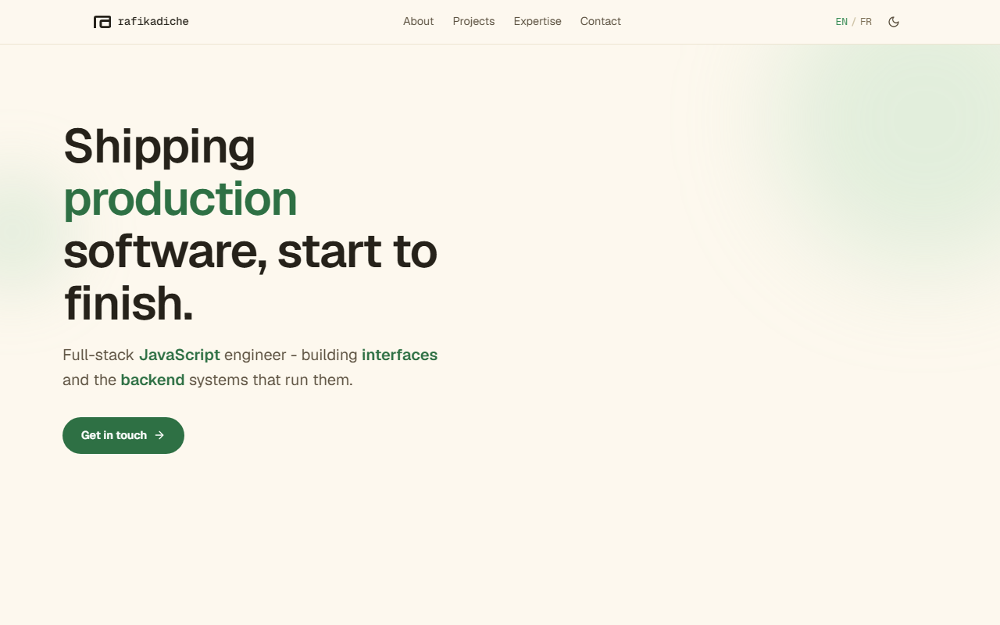
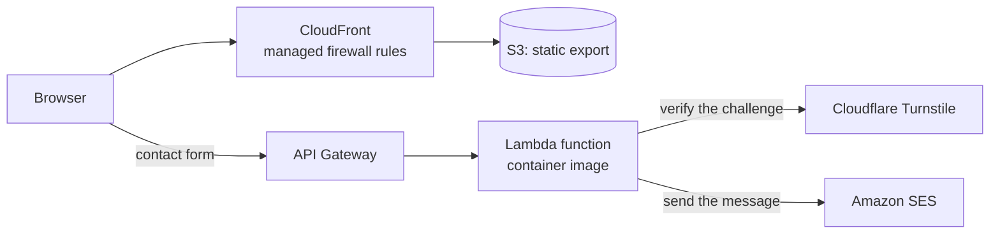

# rafikadiche.com

[Documentation index](../README.md)

[rafikadiche.com](https://rafikadiche.com) is a bilingual static site with one serverless contact API, built and run by one person under a fixed monthly cost ceiling.

## At a glance

| Topic | Summary |
|---|---|
| Product | Portfolio site in English and French, with a contact form |
| Role | Designed, built, deployed and run by one person |
| Frontend | Next.js static export, React, TypeScript, Tailwind CSS, Formik |
| Contact API | Node.js on AWS Lambda from a container image, Amazon API Gateway, Amazon SES |
| Infrastructure | Terraform in layers, Amazon CloudFront, S3, Route 53, ACM, ECR |
| Delivery | GitHub Actions with OIDC for the contact API, manual deploy for the site |
| Environments | Local development and production |

## How it works

The pages are built once and served from a private S3 bucket through CloudFront. The only dynamic part is the contact form. Its API validates the message, confirms the anti-spam challenge on the server and sends an email. Nothing is stored.

## What it demonstrates

- A cost ceiling decided before the design. Static files and one function, with no always-on compute, kept the running cost at about €2 a month in September 2026.
- Spam checks in order: a honeypot, validation, then a server-side check of the anti-spam challenge that fails closed, so a submission is refused when the check cannot be confirmed.
- No personal data on the server. A message only needs to reach an inbox, so the API keeps nothing.
- Keyless deploys for the contact API. GitHub Actions gets short-lived credentials through OIDC, with trust pinned to the repository's immutable identifiers.
- Terraform in layers, bootstrap then platform, each with its own state, because state and deploy identities must exist before the resources that use them.
- A reversed decision kept in the log. Terraform was dropped on 2026-08-06 to protect the launch date, and drift then caused two failures within a week. On 2026-08-12 the decision was reversed and the live resources were imported until a plan showed no difference. Both entries stay in the decision log, the first marked as reversed.
