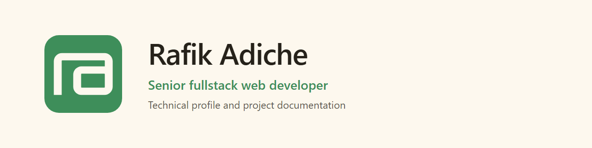
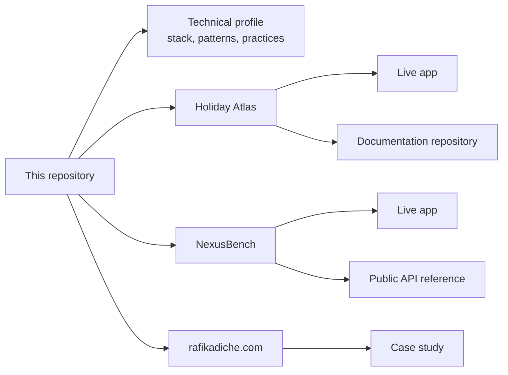

# Rafik Adiche

I'm a full-stack JavaScript developer based in Paris, with 11+ years shipping production web applications, from React and Next.js interfaces to the Node.js and AWS backends that run them. I designed, built and deployed the three projects below myself, and I keep them running. I'm open to freelance and remote engagements.

This repository is the public companion to [rafikadiche.com](https://rafikadiche.com). It presents the technical profile behind the site and links each portfolio project to its live application and its documentation. The source code repositories are private.

## At a glance

| Area | Summary |
|---|---|
| Role | Senior fullstack web developer, JavaScript and TypeScript |
| Experience | 11+ years in banking, retail, cloud, telecom and research teams |
| Frontend | React, Next.js, TypeScript, Tailwind CSS, data visualization |
| Backend | Node.js, NestJS, REST and OpenAPI, DynamoDB, PostgreSQL |
| Cloud and delivery | AWS serverless, Terraform, Docker, GitHub Actions |
| AI integration | Model Context Protocol servers, Claude API, CrewAI, Claude Code |
| Availability | Open to freelance and remote engagements, based in Paris |

## How this repository is organised

The profile pages say what is used and how. Each claim points to the project where it can be checked. The project pages are summaries: the full functional, technical and quality documentation of a project stays in that project's own repository.

## Projects

| Project | What it is | Stack | Links |
|---|---|---|---|
| [Holiday Atlas](02-projects/holiday-atlas.md) | A public API, an MCP server and a web app for public holidays around the world, shown on an interactive globe | Next.js, React, TypeScript, D3, Node.js, AWS Lambda, Terraform, Docker | [Live app](https://holiday-atlas.rafikadiche.com), [documentation](https://github.com/holiday-atlas-org/documentation) |
| [NexusBench](02-projects/nexusbench.md) | A dashboard that compares language models on benchmark scores and token prices, with a public API and an MCP server | Next.js, React, TypeScript, Recharts, NestJS, DynamoDB, AWS Lambda, Step Functions, Terraform | [Live app](https://nexusbench.rafikadiche.com), [API reference](https://nexusbench.rafikadiche.com/api/docs) |
| [rafikadiche.com](02-projects/portfolio-site.md) | A bilingual static site with a serverless contact API, run under a small monthly cost ceiling | Next.js, React, TypeScript, Tailwind CSS, Node.js, AWS Lambda, Terraform | [Live site](https://rafikadiche.com), [case study](02-projects/portfolio-site.md) |

## Skills and where they are shown

| Area | Skills | Shown in |
|---|---|---|
| UI and UX design | User journeys, personas, design tokens, light and dark themes, responsive design, data visualization, accessibility | [Holiday Atlas UX design](https://github.com/holiday-atlas-org/documentation/blob/main/01-functional/ux-design.md), [NexusBench](02-projects/nexusbench.md) |
| Frontend development | React, Next.js, TypeScript, Tailwind CSS, D3, HTML canvas, Recharts, internationalization, static site generation, web performance | [Holiday Atlas frontend](https://github.com/holiday-atlas-org/documentation/blob/main/02-technical/frontend.md), [NexusBench](02-projects/nexusbench.md), [rafikadiche.com](02-projects/portfolio-site.md) |
| Backend development | Node.js, NestJS, REST API design, OpenAPI, MCP servers, CQRS, event-driven architecture, DynamoDB data modelling, schema validation | [Holiday Atlas backend](https://github.com/holiday-atlas-org/documentation/blob/main/02-technical/backend.md), [NexusBench API reference](https://nexusbench.rafikadiche.com/api/docs) |
| Cloud and DevOps | AWS serverless, Terraform, infrastructure as code, Docker, GitHub Actions, CI/CD, OIDC, cost control | [Holiday Atlas infrastructure](https://github.com/holiday-atlas-org/documentation/blob/main/02-technical/infrastructure.md), [rafikadiche.com](02-projects/portfolio-site.md) |
| Quality and security | Unit, component and end-to-end testing, cross-browser testing, WCAG 2.1 AA, performance budgets, least-privilege access, rate limiting | [Holiday Atlas testing](https://github.com/holiday-atlas-org/documentation/blob/main/03-quality/testing.md), [Holiday Atlas security](https://github.com/holiday-atlas-org/documentation/blob/main/03-quality/security.md) |
| AI engineering | Model Context Protocol servers, multi-agent workflows with CrewAI, human review points, agent-assisted delivery | [Holiday Atlas API reference](https://github.com/holiday-atlas-org/documentation/blob/main/02-technical/api-reference.md), [NexusBench](02-projects/nexusbench.md) |

## Documentation map

Technical profile

- [Technical stack](01-profile/technical-stack.md): languages, frameworks and tools by layer, with the project that shows each one.
- [Design patterns](01-profile/design-patterns.md): architecture and design patterns, the problem each one answers and where it is used.
- [Engineering practices](01-profile/engineering-practices.md): testing, delivery, infrastructure as code, security, accessibility, performance and AI-assisted work.

Projects

- [Holiday Atlas](02-projects/holiday-atlas.md): summary, live app and documentation repository.
- [NexusBench](02-projects/nexusbench.md): summary, live app and public API reference.
- [rafikadiche.com](02-projects/portfolio-site.md): a one-page case study of the site itself.

## Client experience

Client roles before these projects include HP / HPE, IRT SystemX, LinkByNet, BNP Paribas, Société Générale, Carrefour and OVHcloud. The full client history is on [LinkedIn](https://www.linkedin.com/in/rafik-adiche-7aa28635).

## Scope of this documentation

The pages describe patterns and public interfaces. They leave out resource identifiers, access policies and operating procedures, which stay in the private repositories. Measured results such as test counts, coverage and audit scores are kept in each project's own documentation, with the date they were taken, and are linked from here instead of copied.

## Contact

- Site and contact form: [rafikadiche.com](https://rafikadiche.com)
- Email: [adicherafik@gmail.com](mailto:adicherafik@gmail.com)
- LinkedIn: [linkedin.com/in/rafik-adiche-7aa28635](https://www.linkedin.com/in/rafik-adiche-7aa28635)
- GitHub: [github.com/rafikadiche](https://github.com/rafikadiche)
